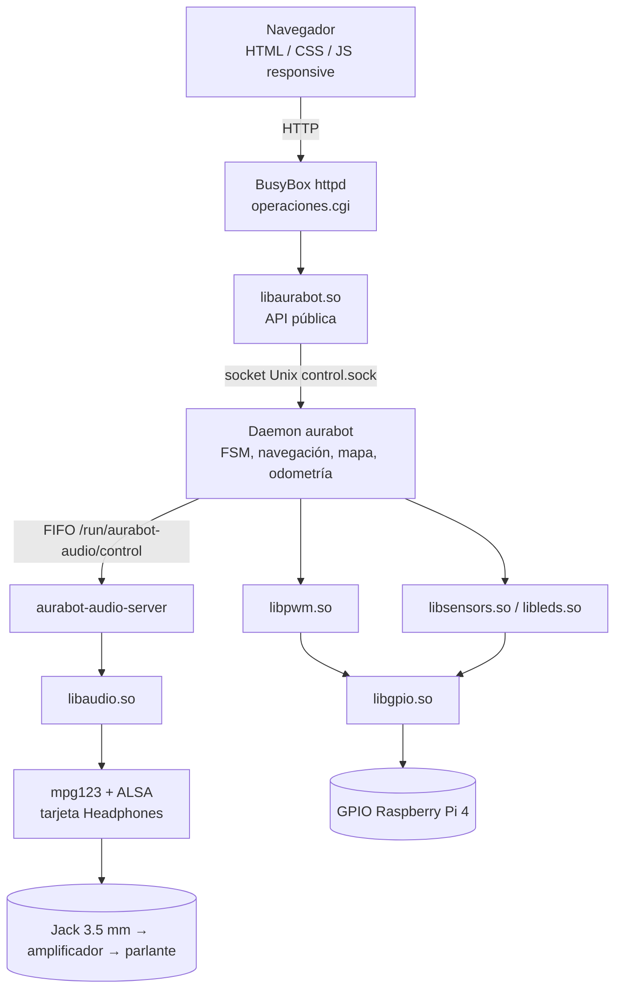
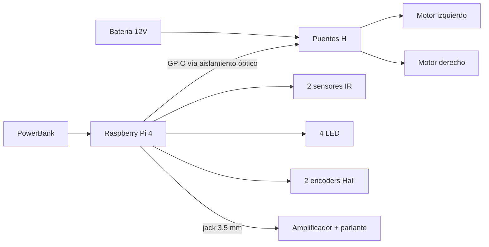
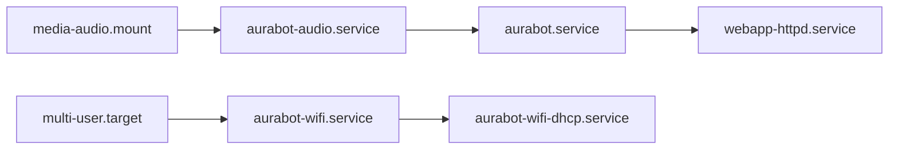

# AuraBot — Robot aspiradora autónomo (CE-1113 Sistemas Empotrados, Proyecto I)

Sistema embebido a la medida para un robot aspiradora autónomo con navegación
reactiva, mapa de recorrido, reproducción de audio MP3 y control remoto desde el
navegador. Corre sobre una **Raspberry Pi 4** con una imagen **Yocto** mínima
(`ce1113-p1`, Yocto Scarthgap) y se compila de forma cruzada con CMake.


**Curso:** CE-1113 Sistemas Empotrados — Escuela de Ingeniería en Computadores, TEC
**Profesor:** Dr.-Ing. Jeferson González Gómez
**Integrantes:**  Jose Bernardo Barquero 2023150476, Alexander Montero 2023166058, Jimmy Feng 2023060347, Jose Edo Campos 2023135620

---

## Tabla de contenido

1. [Características](#1-características)
2. [Arquitectura del sistema](#2-arquitectura-del-sistema)
3. [Estructura del repositorio](#3-estructura-del-repositorio)
4. [Hardware y seguridad eléctrica](#4-hardware-y-seguridad-eléctrica)
5. [Requisitos del host](#5-requisitos-del-host)
6. [Compilación cruzada con CMake](#6-compilación-cruzada-con-cmake)
7. [Generación de la imagen Yocto](#7-generación-de-la-imagen-yocto)
8. [Grabar la SD y cargar música](#8-grabar-la-sd-y-cargar-música)
9. [Configuración y uso](#9-configuración-y-uso)
10. [API de la biblioteca dinámica](#10-api-de-la-biblioteca-dinámica)
11. [Servicios systemd](#11-servicios-systemd)
12. [Eficiencia de recursos](#12-eficiencia-de-recursos)
13. [Justificación de paquetes](#13-justificación-de-paquetes)
14. [Pruebas](#14-pruebas)
15. [Evidencias](#15-evidencias)
16. [Resultados y limitaciones](#16-resultados-y-limitaciones)
17. [Flujo de trabajo Git](#17-flujo-de-trabajo-git)
18. [Documentación adicional](#18-documentación-adicional)

---

## 1. Características

| Área | Qué hace AuraBot |
| --- | --- |
| Navegación autónoma | Cobertura reactiva: al detectar un obstáculo se detiene, retrocede y gira para cambiar de dirección. |
| Obstáculos | Dos sensores infrarrojos (izquierdo y derecho) leídos en tiempo real. |
| Tracción | Dos motores DC con puente H, control diferencial y velocidad por PWM (por software). |
| Indicadores | 4 LED: sistema encendido, modo autónomo, modo manual y obstáculo. |
| Audio | MP3 local concurrente con la navegación (lista, reproducir, pausar, detener, volumen) y sonidos de evento (inicio, autónomo, obstáculo, manual). |
| Mapa | Grilla 2D incremental (celdas de 10 cm: desconocida / recorrida / obstáculo) a partir de sensores y odometría de encoders. |
| Control remoto | Panel web responsive: modo autónomo/manual, control direccional, sensores, LED, audio y mapa en tiempo real. |
| Seguridad de acceso | Login con usuarios en SQLite, hash bcrypt, cookie de sesión, CSRF y roles (`viewer`, `operator`, `admin`). |
| Robustez | Servicios systemd propios con `Restart=on-failure`, parada segura y parada de emergencia. |

---

## 2. Arquitectura del sistema

### 2.1 Software

El daemon `aurabot` es el **único dueño de los GPIO**. El servidor web nunca toca
el hardware: usa exclusivamente la biblioteca propia `libaurabot.so`.



Cadenas de dependencias dinámicas:

```text
aurabot              -> libpwm.so.1 -> libgpio.so.1
aurabot-audio-server -> libaudio.so.1
operaciones.cgi      -> libaurabot.so.1 -> control.sock -> aurabot
```

Módulos principales del daemon (`meta-ce1113/recipes-auraapp/aurabot/files/src/`):

| Módulo | Responsabilidad |
| --- | --- |
| `fsm.c` | Máquina de estados: autónomo, manual y parada segura. |
| `autonomous.c` | Navegación reactiva (parar → retroceder → girar → avanzar). |
| `motion.c`, `odometry.c` | Orden de movimiento por rueda y estimación de posición con encoders. |
| `map.c` | Mapa en grilla de crecimiento dinámico (inicia 21×21, máximo 128×128). |
| `control_lease.c` | Concesión exclusiva del control manual con heartbeat. |
| `ipc_server.c` | Socket Unix que atiende a `libaurabot.so`. |
| `state_outputs.c` | Refleja el estado del robot en los LED. |
| `audio_controller.c` | Envía órdenes al servidor de audio. |

### 2.2 Hardware




### 2.3 Orden de arranque



---

## 3. Estructura del repositorio

```text
CE1113_P1/
├── .github/workflows/validation.yml   # integración continua
├── .githooks/                         # commit-msg y pre-commit
├── docs/{architecture,development,yocto,evidence}/
├── meta-ce1113/                       # capa Yocto del producto (única capa activa)
│   ├── conf/layer.conf
│   ├── recipes-core/                  # imagen ce1113-p1 y packagegroups
│   ├── recipes-lib/                   # libgpio, pwm, audio, leds, sensors, aurabot-api
│   ├── recipes-hw/                    # config física: audio, Wi-Fi, kernel, boot, almacenamiento
│   ├── recipes-auraapp/               # aurabot, aurabot-audio-server, webapp
│   └── recipes-test/                  # apps de prueba (fuera de la imagen final)
├── layers/meta-pwm/                   # referencia experimental (PWM por hardware), fuera del build
├── scripts/                           # check-repository.sh, create-recipe.sh
├── build.sh  check_image.sh  flash_sd.sh  load_audio.sh
└── media/                             # MP3 de ejemplo (no van en la imagen)
```

> **Nota sobre `meta-robot/`:** la especificación pide la capa en un directorio
> `meta-robot/`. En este proyecto la capa se llama `meta-ce1113/`
> (`BBFILE_COLLECTIONS = "ce1113"`) y cumple el mismo papel: contiene el
> `layer.conf` y las recetas `.bb` propias. 

---

## 4. Hardware y seguridad eléctrica

> ⚠️ **Lectura obligatoria.** Conectar un GPIO directamente a la etapa de
> potencia puede destruir la Raspberry Pi. El incumplimiento es responsabilidad
> del grupo.

Reglas aplicadas en el diseño:

- **Aislamiento** entre lógica y motores (optoacopladores o driver aislado). Las
  tierras de lógica y potencia están separadas y solo se unen a través del
  aislador. 
- **Dos rieles independientes:** lógica (Raspberry Pi, sensores, LED, audio) y
  potencia de motores, derivados de la batería y powerbank por separado.
- **BMS** obligatorio para proteger contra sobrecarga, sobredescarga y cortocircuito.

Componentes usados:

- **Driver de motor**  lm298

- **Aislamiento galvanico**  PC123

- **Sensores infrarojos** AD33838

- **Amplificador de audio** PAM8403 2x3W

- **Parlante** CE-SPK-01


### 4.1 Asignación de pines (BCM)

Definida en `meta-ce1113/recipes-auraapp/aurabot/files/src/hardware_config.h`.

| Función | GPIO BCM |
| --- | --- |
| Motor izquierdo: PWM / IN1 / IN2 | 8 / 14 / 15 |
| Motor derecho: PWM / IN1 / IN2 | 7 / 23 / 24 |
| Infrarrojo izquierdo / derecho | 9 / 10 (salida activa en bajo; la biblioteca invierte el nivel) |
| Encoder Hall izquierdo / derecho | 5 / 6 |
| LED servicio activo | 22 |
| LED modo manual | 17 |
| LED modo autónomo | 27 |
| LED obstáculo | 4 (sigue la detección conjunta de ambos sensores) |
| Audio | Jack 3.5 mm (tarjeta ALSA `Headphones`) |

Cada dispositivo se habilita con una macro `AURABOT_*_ENABLE` (1 conectado,
0 omitido), útil para probar con una bancada parcial. **Cada cambio requiere
reconstruir la imagen.**

### 4.2 Decisión de diseño: PWM por software y audio por jack

El jack analógico de la Raspberry Pi 4 genera el audio con los **mismos canales
PWM0/PWM1** del SoC que usaría el PWM por hardware (`pwm-2chan`, GPIO12/13).
Cambiar a GPIO18/19 no lo resuelve porque son los mismos canales internos. Por
eso AuraBot genera el PWM de los motores **por software** (`libpwm.so`, 100 Hz,
sobre GPIO convencionales) y conserva el jack para el audio. La capa
`layers/meta-pwm` queda solo como referencia experimental. Detalle completo en
[`docs/architecture/audio-pwm-conflict.md`](docs/architecture/audio-pwm-conflict.md).

---

## 5. Requisitos del host

- Linux x86_64 (o Windows con WSL2) con al menos ~100 GB libres y 8 GB de RAM para Yocto.
- Dependencias de Yocto Scarthgap (`gawk wget git diffstat unzip texinfo gcc build-essential chrpath socat cpio python3 python3-pip python3-pexpect xz-utils debianutils iputils-ping python3-git python3-jinja2 libegl1-mesa libsdl1.2-dev pylint xterm python3-subunit mesa-common-dev zstd liblz4-tool file locales`).
- `whiptail` (opcional, para las ventanas de los scripts), `sudo` para grabar la SD.
- Para pruebas nativas de C: `cmake`, `gcc`.
- Opcional: Docker + QEMU ARM64 (ver [`docs/development/docker-qemu-environment.md`](docs/development/docker-qemu-environment.md)).

Variables útiles:

| Variable | Descripción | Valor por defecto |
| --- | --- | --- |
| `POKY_DIR` | Árbol de Poky | `$HOME/poky-scarthgap-5.0.19` |

Capas externas necesarias en el árbol de Poky: `meta-raspberrypi` (rama `scarthgap`).
`build.sh` las activa junto con `meta-ce1113`.

---

## 6. Compilación cruzada con CMake

Todo el código de producción se compila **dentro de Yocto** con la toolchain del
SDK (`inherit cmake`), por lo que no hay que copiar binarios a mano al target.
Para verificar rápido en el host (compilación **nativa**, solo para detectar
roturas de C/CMake y ejecutar las pruebas):

```bash
cmake -S meta-ce1113/recipes-auraapp/aurabot/files -B build-native
cmake --build build-native --parallel
ctest --test-dir build-native --output-on-failure
```

Para compilar una receta para ARM con la toolchain de Yocto:

```bash
cd $POKY_DIR
source oe-init-build-env build-raspberrypi4
bitbake aurabot            # biblioteca/daemon
bitbake aurabot-audio-server
```

El archivo `log.do_compile` de cada receta confirma la compilación cruzada
(compilador `*-linux-gnueabi-gcc`). Ver [§15 Evidencias](#15-evidencias).

---

## 7. Generación de la imagen Yocto

### 7.1 Receta propia y composición

La imagen `ce1113-p1` (`meta-ce1113/recipes-core/images/ce1113-p1.bb`) parte de
`core-image-minimal`, no instala idiomas extra y genera `ext4`, `tar.bz2` y
`wic.bz2`. Instala únicamente `packagegroup-ce1113`:

```text
ce1113-p1
└── packagegroup-ce1113
    ├── packagegroup-ce1113-lib      libgpio, pwm, audio, leds, sensors, aurabot-api
    ├── packagegroup-ce1113-hw       audio, Wi-Fi, firmware, udev, systemd-analyze
    └── packagegroup-ce1113-auraapp  aurabot, aurabot-audio-server, webapp
```

Recetas propias que integran el software en la imagen (todas con `inherit cmake`
y, cuando aplica, `inherit systemd`):

| Receta | Instala |
| --- | --- |
| `recipes-lib/libgpio`, `pwm`, `audio`, `leds`, `sensors`, `aurabot-api` | Bibliotecas dinámicas `.so` |
| `recipes-auraapp/aurabot/aurabot_1.0.0.bb` | Daemon, `aurabot.service`, `aurabot-metrics` |
| `recipes-auraapp/aurabot-audio-server/aurabot-audio-server_1.0.0.bb` | Servidor de audio, `aurabot-audio.service`, 4 sonidos de evento |
| `recipes-auraapp/webapp` | CGI, frontend y servicio HTTP |

Cada receta declara `SUMMARY`, `LICENSE`, `LIC_FILES_CHKSUM`, `SRC_URI` (fuentes en
`files/` junto a la receta), `DEPENDS`/`RDEPENDS` y los artefactos instalados.

### 7.2 Agregar la capa a un build propio

Si no usan `build.sh`, agreguen las capas manualmente:

```bash
cd $POKY_DIR
source oe-init-build-env build-raspberrypi4
bitbake-layers add-layer ../meta-raspberrypi
bitbake-layers add-layer /ruta/a/CE1113_P1/meta-ce1113
```

En `conf/local.conf`:

```bitbake
MACHINE = "raspberrypi4"
INIT_MANAGER = "systemd"
```

> `meta-pwm` **no** se agrega: audio analógico y `pwm-2chan` son mutuamente
> excluyentes (ver §4.2).

### 7.3 Construir (un solo comando)

La vía soportada es `build.sh`, que activa las capas, ejecuta `bitbake ce1113-p1`
y deja la huella de metadata que exige el verificador:

```bash
cd ~/CE1113_P1
./scripts/check-repository.sh      # valida estructura del repo
./build.sh --no-ui                 # genera la imagen
./check_image.sh --no-ui           # verifica integridad
```

Equivalente directo: `bitbake ce1113-p1`. Solo se debe flashear si
`check_image.sh` termina con `RESULTADO: ÍNTEGRA`.

Artefactos en `<poky>/build-raspberrypi4/tmp/deploy/images/raspberrypi4/`:

| Artefacto | Uso |
| --- | --- |
| `*.wic.bz2` | Disco arrancable completo (se graba con `flash_sd.sh`) |
| `*.manifest` | Lista exacta de paquetes |
| `*.ext4`, `*.tar.bz2` | Rootfs aislado / extracción manual |

### 7.4 Credenciales de la web

La receta incluye credenciales **solo de desarrollo**. Antes de construir la
imagen entregable, sobrescriban en `conf/local.conf`:

```bitbake
AURABOT_WEB_USERNAME = "admin"
AURABOT_WEB_PASSWORD_HASH = "$2b$12$...hash-bcrypt-completo..."
```

Las contraseñas aceptadas tienen entre 4 y 12 caracteres. No publiquen la clave
Wi-Fi ni contraseñas reales en el repositorio.

---

## 8. Grabar la SD y cargar música

```bash
./flash_sd.sh                      # selección guiada del disco completo
./flash_sd.sh --device /dev/sdX    # o indicar el dispositivo
```

> ⚠️ Destruye todos los datos del disco indicado. Use siempre el **disco completo**
> (por ejemplo `/dev/mmcblk0`), nunca una partición. El script verifica la
> integridad, relee lo escrito y compara el SHA-256 contra el WIC.

La SD queda con tres particiones: arranque FAT, rootfs ext4 y una tercera
partición ext4 de ~2 GiB etiquetada `AURA_AUDIO` (montada en `/media/audio`) que
**conserva las canciones entre flasheos**. Los MP3 no forman parte de la imagen:

```bash
./load_audio.sh                    # copia ./media a AURA_AUDIO y regenera playlist.txt
./load_audio.sh --source ./audios
```

Flujo completo recomendado:

```text
check-repository.sh → build.sh → check_image.sh → flash_sd.sh → load_audio.sh
```

Detalles y recuperación ante fallos de lectura: [`docs/development/image-scripts.md`](docs/development/image-scripts.md).

---

## 9. Configuración y uso

### 9.1 Primer arranque

1. Apague siempre con `poweroff` antes de retirar la alimentación (evita dañar el sistema de archivos).
2. El robot arranca en **modo autónomo** y puede mover los motores de inmediato: haga la primera prueba **con las ruedas levantadas**.
3. Se conecta a la red Wi-Fi configurada en `wifi-config` (interfaz `wlan0`). 
4. Abra en el navegador la dirección IP que le entregó el router. 

> HTTP sin TLS: use una WLAN de confianza protegida con WPA2.

### 9.2 Panel web

1. Inicie sesión.
2. **Modo:** el interruptor alterna autónomo/manual. En manual pulse **Tomar control** (solo una pestaña puede conducir) y mantenga pulsada una dirección; al soltar, los motores se detienen. **Liberar control** al terminar.
3. **Parada de emergencia:** botón separado, disponible para cualquier usuario autenticado; lleva el robot a parada segura. Use **Seleccionar manual** para salir de ella.
4. **Audio:** elija canción de la lista, reproduzca, pause, detenga y ajuste el volumen (0–100 %).
5. **Mapa:** se actualiza en tiempo real; se puede arrastrar, acercar, alejar y recentrar. Es un mapa aproximado (no SLAM).

Roles: `viewer` (consulta y parada de emergencia), `operator` (además conduce y controla audio), `admin` (además administra usuarios).

### 9.3 Seguridad operativa del control remoto

- La pestaña que controla renueva su concesión cada 700 ms; sin renovación durante 3000 ms el robot se detiene y libera el control.
- Perder el foco, ocultar la pestaña o soltar el botón detiene el movimiento.
- Si se ordena movimiento y no llegan pulsos de encoder durante 1000 ms, el robot entra en parada segura.
- Una segunda instancia del daemon es rechazada para no tener dos procesos sobre los GPIO.

### 9.4 Diagnóstico en el target

```sh
aurabotctl status                              # modo, sensores, motores, LED
systemctl status aurabot.service aurabot-audio.service webapp-httpd.service
journalctl -b -u aurabot.service -f
wpa_cli -i wlan0 status
```

`mode=1` autónomo, `mode=2` manual, `mode=3` parada segura; `sensors=L,R` usa 1 para obstáculo.
Más detalle en [`docs/aurabot-diagnostico.md`](docs/aurabot-diagnostico.md).

---

## 10. API de la biblioteca dinámica

`libaurabot.so` es la **única** vía por la que el servidor web accede al
hardware. Trabaja con conceptos del robot (motor izquierdo/derecho, sensores,
LED, volumen) y **no expone números de GPIO ni configuración de PWM**. El
contrato público está en
`meta-ce1113/recipes-lib/aurabot-api/files/include/aurabot.h`.

Funciones destacadas:

| Función | Descripción |
| --- | --- |
| `aurabot_get_capabilities` | Hardware habilitado en esta imagen. |
| `aurabot_get_map_snapshot` | Celdas del mapa y su revisión en una misma respuesta. |
| `aurabot_set_mode_controlled` | Cambio de modo respetando al propietario del control. |
| `aurabot_audio_set_device` | Selección de tarjeta ALSA desde el daemon. |

## API de AuraBot

### Códigos de retorno

Las funciones de `aurabot.h` que retornan `int` utilizan los siguientes códigos de estado:

| Código | Significado |
|---|---|
| `AURABOT_OK` (`0`) | Operación exitosa. |
| `AURABOT_ERR_INVALID_ARGUMENT` (`-1`) | Argumento, puntero, tamaño o valor no válido. |
| `AURABOT_ERR_NOT_OWNER` (`-2`) | El cliente no posee el control del robot. |
| `AURABOT_ERR_WRONG_MODE` (`-3`) | La operación no está permitida en el modo actual. |
| `AURABOT_ERR_BUSY` (`-4`) | El recurso o control solicitado está ocupado. |
| `AURABOT_ERR_HARDWARE` (`-5`) | Error al operar un componente de hardware. |
| `AURABOT_ERR_PROTOCOL` (`-6`) | Error de comunicación o respuesta incompatible con el protocolo. |
| `AURABOT_ERR_UNAVAILABLE` (`-7`) | El servicio no está disponible o no responde dentro del tiempo esperado. |

Los errores específicos que puede retornar cada función dependen de la operación y de la respuesta del servidor. Las funciones que reciben punteros también pueden rechazar argumentos nulos.

### Funciones de conexión y consulta

| Función | Parámetros | Retorno | Errores |
|---|---|---|---|
| `aurabot_connect()` | Ninguno. | `int`: `AURABOT_OK` si conecta. | `AURABOT_ERR_PROTOCOL`, `AURABOT_ERR_UNAVAILABLE`. |
| `aurabot_disconnect()` | Ninguno. | `void`. | No retorna código de error. |
| `aurabot_get_status(aurabot_status_t *status)` | `status`: estructura donde se almacenará el estado del robot. | `int`: estado de la operación. | `INVALID_ARGUMENT`, `PROTOCOL`, `UNAVAILABLE`; también errores de comunicación. |
| `aurabot_get_capabilities(aurabot_capabilities_t *capabilities)` | `capabilities`: estructura donde se almacenan las capacidades disponibles. | `int`: estado de la operación. | `INVALID_ARGUMENT`, `PROTOCOL`, `UNAVAILABLE`; también errores de comunicación. |

`aurabot_status_t` contiene el modo actual, el estado de navegación, las velocidades y direcciones de los motores, las lecturas de obstáculos, la posición estimada, la revisión del mapa y el estado del audio y los LEDs.

`aurabot_capabilities_t` indica la disponibilidad de motores, encoders, sensores, audio y LEDs.

### Funciones de modo de operación y control

| Función | Parámetros | Retorno | Errores |
|---|---|---|---|
| `aurabot_set_mode(aurabot_mode_t mode)` | `mode`: modo solicitado (`INIT`, `AUTONOMOUS`, `MANUAL` o `SAFE_STOP`). | `int`: estado de la operación. | `INVALID_ARGUMENT`, `WRONG_MODE`, `HARDWARE`, `PROTOCOL`, `UNAVAILABLE`, según la respuesta. |
| `aurabot_set_mode_controlled(aurabot_mode_t mode, const unsigned char owner_token[AURABOT_OWNER_TOKEN_SIZE])` | `mode`: modo solicitado. `owner_token`: token del cliente propietario del control. | `int`: estado de la operación. | `INVALID_ARGUMENT` si el token es nulo; también `NOT_OWNER`, `WRONG_MODE`, `BUSY`, `HARDWARE` u otros errores del servidor. |
| `aurabot_claim_control(const unsigned char owner_token[AURABOT_OWNER_TOKEN_SIZE])` | `owner_token`: token de 32 bytes que identifica al propietario del control. | `int`: estado de la solicitud. | `INVALID_ARGUMENT` si el token es nulo; puede retornar `BUSY`, `NOT_OWNER` u otros errores del servidor. |
| `aurabot_control_heartbeat(const unsigned char owner_token[AURABOT_OWNER_TOKEN_SIZE])` | `owner_token`: token del cliente que mantiene el control. | `int`: estado de la operación. | `INVALID_ARGUMENT` si el token es nulo; puede retornar `NOT_OWNER` u otros errores del servidor. |
| `aurabot_release_control(const unsigned char owner_token[AURABOT_OWNER_TOKEN_SIZE])` | `owner_token`: token del propietario que libera el control. | `int`: estado de la operación. | `INVALID_ARGUMENT` si el token es nulo; puede retornar `NOT_OWNER` u otros errores del servidor. |
| `aurabot_drive(const unsigned char owner_token[AURABOT_OWNER_TOKEN_SIZE], int left_percent, int right_percent)` | `owner_token`: propietario del control. `left_percent`, `right_percent`: valores de control de cada motor. | `int`: estado de la operación. | `INVALID_ARGUMENT`, `NOT_OWNER`, `WRONG_MODE`, `BUSY`, `HARDWARE`, `PROTOCOL` o `UNAVAILABLE`, según la solicitud. |
| `aurabot_stop(const unsigned char owner_token[AURABOT_OWNER_TOKEN_SIZE])` | `owner_token`: token del propietario del control. | `int`: estado de la operación. | `INVALID_ARGUMENT` si el token es nulo; también pueden producirse errores de propiedad, modo, hardware o comunicación. |
| `aurabot_emergency_stop()` | Ninguno. | `int`: estado de la solicitud de parada de emergencia. | Errores de hardware, protocolo o disponibilidad, según la respuesta. |

El control manual utiliza una concesión temporal de `AURABOT_CONTROL_LEASE_MS`, definida en el encabezado como 3000 ms. El cliente debe renovar el control mediante `aurabot_control_heartbeat()` cuando corresponda.

### Funciones de acceso directo al hardware

| Función | Parámetros | Retorno | Errores |
|---|---|---|---|
| `aurabot_digital_write(int pin, int value)` | `pin`: GPIO objetivo. `value`: nivel digital (`0` o `1`). | `int`: estado de la operación. | `INVALID_ARGUMENT`, `WRONG_MODE`, `HARDWARE`, `PROTOCOL` o `UNAVAILABLE`, según la respuesta. |
| `aurabot_pwm_set(int pin, int frequency, int duty)` | `pin`: GPIO objetivo. `frequency`: frecuencia en Hz. `duty`: ciclo de trabajo en porcentaje. | `int`: estado de la operación. | `INVALID_ARGUMENT`, `WRONG_MODE`, `HARDWARE`, `PROTOCOL` o `UNAVAILABLE`, según la respuesta. |
| `aurabot_pwm_stop(int pin)` | `pin`: GPIO cuya generación PWM debe detenerse. | `int`: estado de la operación. | `INVALID_ARGUMENT`, `WRONG_MODE`, `HARDWARE`, `PROTOCOL` o `UNAVAILABLE`, según la respuesta. |

Estas funciones se destinan a pruebas de GPIO y PWM sobre pines libres, con el robot en modo manual. No deben utilizarse para controlar pines que estén siendo administrados por otro subsistema.

### Funciones del mapa

| Función | Parámetros | Retorno | Errores |
|---|---|---|---|
| `aurabot_get_map(unsigned char *cells, unsigned int capacity, unsigned int *required_size)` | `cells`: búfer de salida. `capacity`: capacidad del búfer. `required_size`: espacio necesario para el mapa actual. | `int`: estado de la operación. | `INVALID_ARGUMENT` si `required_size` es nulo, `cells` es nulo o la capacidad es insuficiente; también errores de protocolo o disponibilidad. |
| `aurabot_get_map_snapshot(aurabot_map_snapshot_t *map)` | `map`: estructura de salida con dimensiones, origen, revisión y celdas del mapa. | `int`: estado de la operación. | `INVALID_ARGUMENT` si `map` es nulo; `PROTOCOL` si la respuesta contiene dimensiones o tamaños inconsistentes; también errores de comunicación. |

El mapa utiliza celdas de 100 mm y admite dimensiones máximas de 128 × 128. Los valores de cada celda se representan mediante `AURABOT_CELL_UNKNOWN`, `AURABOT_CELL_VISITED` y `AURABOT_CELL_OBSTACLE`.

### Funciones de reproducción de audio

| Función | Parámetros | Retorno | Errores |
|---|---|---|---|
| `aurabot_audio_play(unsigned int track_index)` | `track_index`: índice de la pista que se desea reproducir. | `int`: estado de la solicitud. | `INVALID_ARGUMENT`, `HARDWARE`, `PROTOCOL`, `UNAVAILABLE` u otro error del servidor. |
| `aurabot_audio_pause()` | Ninguno. | `int`: estado de la operación. | Errores de hardware, protocolo o disponibilidad. |
| `aurabot_audio_stop()` | Ninguno. | `int`: estado de la operación. | Errores de hardware, protocolo o disponibilidad. |
| `aurabot_audio_set_volume(int volume_percent)` | `volume_percent`: volumen solicitado en porcentaje. | `int`: estado de la operación. | `INVALID_ARGUMENT` si el valor no es aceptado; también errores de hardware, protocolo o disponibilidad. |
| `aurabot_audio_set_device(int card)` | `card`: índice de tarjeta de audio, entre 0 y 31. | `int`: estado de la operación. | `INVALID_ARGUMENT` si `card` está fuera del intervalo permitido; también errores del servidor. |
| `aurabot_audio_get_track_count(unsigned int *track_count)` | `track_count`: puntero donde se almacena la cantidad de pistas. | `int`: estado de la operación. | `INVALID_ARGUMENT` si el puntero es nulo o la respuesta no tiene el tamaño esperado; también errores de comunicación. |
| `aurabot_audio_get_track_name(unsigned int track_index, char *name, unsigned int capacity)` | `track_index`: índice de la pista. `name`: búfer de salida. `capacity`: capacidad del búfer. | `int`: estado de la operación. | `INVALID_ARGUMENT` si el búfer es nulo, su capacidad es cero, el nombre no cabe o la respuesta no es válida; también errores de comunicación. |

### Constantes y estructuras públicas

| Elemento | Descripción |
|---|---|
| `AURABOT_OWNER_TOKEN_SIZE` | Tamaño del token de control: 32 bytes. |
| `AURABOT_MAP_MAX_WIDTH` / `AURABOT_MAP_MAX_HEIGHT` | Dimensiones máximas del mapa: 128 × 128 celdas. |
| `AURABOT_MAP_CELL_MM` | Tamaño representado por una celda: 100 mm. |
| `AURABOT_TRACK_NAME_SIZE` | Tamaño máximo del búfer de nombre de pista: 128 bytes. |
| `AURABOT_CONTROL_LEASE_MS` | Duración de la concesión de control: 3000 ms. |
| `aurabot_mode_t` | Modos de operación del robot. |
| `aurabot_auto_state_t` | Estados internos de navegación autónoma. |
| `aurabot_cell_t` | Clasificación de las celdas del mapa. |
| `aurabot_audio_state_t` | Estados del reproductor de audio. |
| `aurabot_result_t` | Códigos de retorno de la API. |
| `aurabot_status_t` | Estado actual de navegación, hardware, mapa y audio. |
| `aurabot_map_snapshot_t` | Instantánea del mapa, incluyendo dimensiones, origen y celdas. |
| `aurabot_capabilities_t` | Disponibilidad de los periféricos del robot. |

## Biblioteca `libgpio.h`

La biblioteca encapsula el acceso a los GPIO mediante la interfaz de exportación de GPIO de Linux en `/sys/class/gpio`.

| Función | Parámetros | Retorno | Errores |
|---|---|---|---|
| `pinMode(int pin, const char *mode)` | `pin`: número de GPIO utilizado por la biblioteca. `mode`: `"in"` para entrada o `"out"` para salida. | `int`: `0` si funciona; `-1` si falla. | `EINVAL` si el pin o modo no es válido; errores de exportación, permisos, acceso o espera del atributo GPIO. |
| `digitalWrite(int pin, int value)` | `pin`: GPIO objetivo. `value`: nivel `0` o `1`. | `int`: `0` si funciona; `-1` si falla. | `EINVAL` para parámetros no válidos; también errores de apertura o escritura en sysfs. |
| `digitalRead(int pin)` | `pin`: GPIO del que se desea leer el nivel. | `int`: `0` o `1` si funciona; `-1` si falla. | `EINVAL` para un pin no válido; también errores de apertura o lectura. |

Los errores se reportan mediante `errno`. Entre los posibles valores se encuentran `EINVAL`, `ENOENT`, `EACCES`, `EIO` y otros asociados con las operaciones de archivos del sistema.

## Biblioteca `libpwm.h`

La biblioteca genera PWM por software mediante hilos y operaciones sobre GPIO. Cada canal mantiene la frecuencia y el ciclo de trabajo configurados.

| Función | Parámetros | Retorno | Errores |
|---|---|---|---|
| `setPWM(int pin, int frequency_hz, int duty_percent)` | `pin`: GPIO entre 0 y 63. `frequency_hz`: frecuencia mayor que 0 y no superior a 1 000 000 000 Hz según la validación de la función. `duty_percent`: ciclo de trabajo entre 0 y 100 %. | `int`: `0` si se inicia o actualiza el canal; `-1` si falla. | `EINVAL` para parámetros fuera de rango; errores de GPIO; error de creación del hilo, comunicado mediante `errno`. |
| `stopPWM(int pin)` | `pin`: GPIO del canal PWM que se desea detener, entre 0 y 63. | `int`: `0` si funciona; `-1` si falla. | `EINVAL` para un pin fuera de rango; errores al escribir el GPIO o al esperar la finalización del hilo. |

La generación PWM depende de la planificación de Linux y de la temporización por software. Por ello, la frecuencia y el ciclo de trabajo solicitados no garantizan una señal perfectamente periódica bajo carga del sistema.

## Biblioteca `libsensors.h`

| Función | Parámetros | Retorno | Errores |
|---|---|---|---|
| `sensorReadDigital(int pin, int active_low)` | `pin`: GPIO del sensor. `active_low`: distinto de cero si el sensor utiliza lógica activa en bajo. | `int`: `0` o `1` con el estado normalizado; `-1` si falla la configuración o lectura. | Hereda los errores de `pinMode()` y `digitalRead()`. |

La función configura el pin como entrada y normaliza la lectura para que el valor lógico resultante represente el estado del sensor de acuerdo con el parámetro `active_low`.

## Consideraciones sobre los errores

Los códigos enumerados para `aurabot.h` se encuentran definidos en la API pública. Sin embargo, no todas las funciones pueden producir todos los códigos: la respuesta depende de la validación local, la operación solicitada y el resultado del servidor.

En las bibliotecas `libgpio` y `libpwm`, los errores se expresan como `-1` y se acompañan de `errno`. El detalle exacto depende de la operación que falle. Para documentar exhaustivamente cada condición, deben contrastarse también las implementaciones `.c` y las validaciones del servidor, no únicamente los prototipos de los encabezados.


Notas de uso: cada petición CGI abre su propia conexión y la cierra al terminar;
la API mantiene una conexión global por proceso y **no es reentrante** para varios hilos.

### 10.1 Contrato HTTP

Ruta: `/cgi-bin/operaciones.cgi`. Las respuestas son JSON con `ok`; los errores incluyen `code` y `error`.
Los POST usan `application/x-www-form-urlencoded` con `op` como primer campo.

| Operación | Método | Parámetros |
| --- | --- | --- |
| `auth-status` | GET | — (única lectura pública) |
| `auth-login` | POST | `username`, `password` |
| `auth-logout` | POST | cookie de sesión |
| `auth-users` / `auth-user-create` / `auth-user-update` / `auth-user-password` / `auth-user-delete` | GET/POST | solo `admin` |
| `robot-status`, `robot-map` | GET | — |
| `robot-mode` | POST | `mode` (1 autónomo, 2 manual), `token` |
| `robot-claim`, `robot-heartbeat`, `robot-release`, `robot-stop` | POST | `token` |
| `robot-drive` | POST | `token`, `left` y `right` en [-100, 100] |
| `robot-emergency-stop` | POST | — |

Todas las rutas (salvo `auth-status` y `auth-login`) exigen la cookie de sesión
(HTTP 401 si falta o expiró) y los POST exigen además el token `csrf`.

### 10.2 Protocolo del servidor de audio (FIFO)

`/run/aurabot-audio/control` acepta: `PLAY`, `PAUSE`, `STOP`, `VOLUME 0..100`,
`DEVICE <n>`, `TRACK <índice>`, `EVENT boot|manual|autonomous|obstacle`.
Los eventos interrumpen la canción en curso y la reanudan en el mismo punto.

---

## 11. Servicios systemd

| Unidad | Función | Reinicio |
| --- | --- | --- |
| `aurabot-audio.service` | Servidor de audio (FIFO) | `Restart=on-failure` |
| `aurabot.service` | Daemon de control del robot | `Restart=on-failure` |
| `webapp-httpd.service` | BusyBox httpd + CGI | `Restart=on-failure` |
| `aurabot-wifi.service` | `wpa_supplicant` (cliente) | `Restart=on-failure` |
| `aurabot-wifi-dhcp.service` | Cliente DHCP | `Restart=on-failure` |

Se habilitan durante la construcción de la imagen (`multi-user.target`), no hay
interfaz gráfica local y cada unidad usa `StartLimitBurst` para evitar ciclos de
reinicio infinitos. Detalle en [`docs/development/systemd-services.md`](docs/development/systemd-services.md).

---

## 12. Eficiencia de recursos

Se mide **en el target** con el script incluido en la imagen:

```sh
aurabot-metrics | tee /media/audio/aurabot-metrics.txt
```

con navegación autónoma, audio y una sesión web activos simultáneamente.

| Métrica | Herramienta / método | Referencia | Resultado |
| --- | --- | --- | --- |
| Tamaño del rootfs | `df -kP /` y `du -skx /` | ≤ 200 MB | **PENDIENTE** |
| Tiempo de arranque hasta servicio operativo | `systemd-analyze time` y `systemd-analyze critical-chain webapp-httpd.service` | ≤ 15 s | **PENDIENTE** |
| RAM en operación normal | `free -b` y `systemctl show <servicio> -p MemoryCurrent` | — | **PENDIENTE** |
| CPU en operación normal | `systemctl show <servicio> -p CPUUsageNSec` (muestra de 5 s) | — | **PENDIENTE** |

> **PENDIENTE:** copiar la salida real a `docs/evidence/aurabot-metrics.txt` y
> resumir aquí los valores. Si el rootfs supera 200 MB o el arranque supera 15 s,
> añadir la justificación técnica (qué paquetes lo causan y por qué son indispensables).

---

## 13. Justificación de paquetes

Base: `core-image-minimal` (sin interfaz gráfica ni paquetes de prueba). Todo lo
agregado más allá de esa base:

| Paquete | Por qué es necesario |
| --- | --- |
| `libgpio`, `pwm`, `leds`, `sensors` | Bibliotecas propias de acceso a GPIO, PWM por software, LED y sensores. |
| `audio` (`libaudio`) | Biblioteca propia que controla `mpg123` y el volumen ALSA. |
| `aurabot-api` (`libaurabot`) | API única de control para el servidor web. |
| `aurabot` | Daemon de navegación, mapa y control; instala `aurabot-metrics`. |
| `aurabot-audio-server` | Reproducción MP3 concurrente y sonidos de evento. |
| `webapp` | CGI en C y frontend responsive del panel de control. |
| BusyBox con httpd/CGI | Servidor web liviano; evita Python/Flask y reduce el rootfs. |
| SQLite y `libxcrypt` (bcrypt) | Base de usuarios y hash de contraseñas para el login. 
| `mpg123` | Decodificador/reproductor MP3. |
| `packagegroup-base-alsa`, `alsa-utils-amixer` | Soporte ALSA y control de volumen. |
| `kernel-module-snd-bcm2835-*` | Controlador del audio analógico (jack 3.5 mm). |
| `ce1113-audio-config` | Activa `snd-bcm2835` y la tarjeta `Headphones`. |
| `audio-storage` | Monta la partición `AURA_AUDIO` en `/media/audio`. |
| `udev-rules-rpi` | Reglas de dispositivos de la Raspberry Pi. |
| `wifi-config`, `wpa-supplicant`, `wireless-regdb` | Conexión Wi-Fi cliente y regulación regional. |
| `linux-firmware-rpidistro-bcm43455`, `brcmfmac-firmware-fix`, `kernel-module-brcmfmac`, `kernel-module-brcmfmac-wcc` | Firmware y controlador del chip Wi-Fi de la Raspberry Pi 4. |
| `systemd-analyze` | Medir el tiempo de arranque (métrica obligatoria). |

Se excluyen deliberadamente `kernel-modules` (metapaquete global), aplicaciones
de prueba (`packagegroup-ce1113-test`), acceso SSH sin contraseña y cualquier GUI.

---

## 14. Pruebas

| Prueba | Cómo ejecutarla |
| --- | --- |
| Validación de repositorio y recetas | `./scripts/check-repository.sh` |
| Compilación nativa CMake | ver §6 |
| Pruebas C del núcleo (FSM, mapa, hardware parcial) | `ctest --test-dir build-native` |
| Prueba de PWM con GPIO falso (transiciones, apagado, 2 Hz, recuperación) | `ctest` en la receta `pwm` |
| Integración HTTP con hardware simulado | `node scripts/test-web-integration.mjs --daemon BIN_SIMULADO --cgi CGI` (daemon compilado con `AURABOT_FAKE_HARDWARE=ON`) |
| Integridad de la imagen | `./check_image.sh --no-ui` |
| Lectura de la SD | `bash scripts/test-flash-readback.sh` |

La integración HTTP cubre login correcto/incorrecto, SQLite, bcrypt, CSRF,
permisos por rol, expiración de sesión, acceso no autorizado, exclusión entre dos
clientes, renovación y expiración de la concesión, mapa, audio, validación de
parámetros y parada de emergencia. **QEMU no reemplaza las pruebas en la
Raspberry Pi:** GPIO, PWM, motores, sensores, audio físico y temporización deben
verificarse en el hardware real.

La integración continua (`.github/workflows/validation.yml`) corre en cada push
y Pull Request hacia `develop` y `main`: valida el repositorio y compila de forma
nativa las mismas fuentes que consume la receta `aurabot`.

---

## 15. Evidencias

Guardar en `docs/evidence/` (con fecha, commit, imagen y condiciones de prueba en `target-run.md`):

| Evidencia | Archivo | Estado |
| --- | --- | --- |
| Fragmento de `log.do_compile` con compilador ARM y enlazado exitosos | `log-do-compile-arm.txt` | PENDIENTE |
| SHA-256 del WIC y manifest | salida de `check_image.sh --report` | PENDIENTE |
| Ejecución de servicios y reinicio (`NRestarts` aumenta tras `systemctl kill`) | `systemd-target.txt` | PENDIENTE |
| Métricas de recursos | `aurabot-metrics.txt` | PENDIENTE |
| `aurabotctl status` con ambos sensores y 4 LED | captura | PENDIENTE |
| Panel web autenticado con mapa y audio | captura | PENDIENTE |
| MP3 reproduciéndose mientras el robot navega | captura/video | PENDIENTE |
| Transición autónomo/manual y reacción ante obstáculo | video | PENDIENTE |
| Circuito: aislamiento, BMS y rieles separados | fotos y esquemático | PENDIENTE |

Cómo obtener el log de compilación cruzada:

```sh
find "$POKY_DIR/build-raspberrypi4" -path '*/temp/log.do_compile' \
  \( -path '*aurabot/*' -o -path '*aurabot-api/*' -o -path '*webapp/*' \) -print
```

---

## 16. Resultados y limitaciones

**Resultados verificados en software** (pruebas con hardware simulado, CI y build Yocto completo):
navegación reactiva, mapa, concesión de control, autenticación y roles, API HTTP,
servicio de audio y verificación de imagen.

**PENDIENTE:** resumir los resultados obtenidos en el robot físico (recorrido
real, giro, concurrencia audio/navegación, PWM) con enlaces a las evidencias.

Limitaciones conocidas:

- Infrarrojos digitales (obstáculo / libre): el mapa es aproximado y no equivale a SLAM.
- PWM por software: sin la temporización determinista del PWM por hardware.
- HTTP sin TLS: usar solo en una WLAN de confianza.
- El estado de audio en la web refleja las órdenes aceptadas; no confirma fin de pista ni errores del reproductor.
- La playlist se edita con `load_audio.sh`, no desde el panel.
- Requerimientos opcionales (detección de desnivel, notificación de fin de ciclo, playlist editable en la web): no implementados. **PENDIENTE:** ajustar si se implementó alguno.

---

## 17. Flujo de trabajo Git

- Ramas permanentes: `main` (estable, solo vía Pull Request con ≥ 1 reviewer) y `develop` (integración).
- Ramas de trabajo desde `develop` con formato `tipo/descripcion-corta`: `feature/`, `fix/`, `task/`, `docs/`, `test/`, `refactor/`. Se eliminan al integrar el PR.
- Planeamiento y seguimiento de tareas y errores con **Issues**.
- Activar los hooks una vez por clon:

```bash
git config core.hooksPath .githooks
```

Convención de commits actual (validada por el hook `commit-msg`):

```text
[ADD] Agrega módulo de control de motores
[FIX] Corrige lectura del sensor frontal
[UPDATE][TEST] Actualiza control de motores y sus pruebas
```

---

## 18. Documentación adicional

- [Estructura del repositorio](docs/development/repository-structure.md)
- [Imágenes Yocto](docs/yocto/images.md) y [cómo extender recetas](docs/yocto/extending.md)
- [Scripts de build, check y flash](docs/development/scripts.md)
- [API de hardware](docs/architecture/hardware-api.md)
- [Audio](docs/architecture/audio.md) y [conflicto audio/PWM](docs/architecture/audio-pwm-conflict.md)
- [Control web y contrato HTTP](docs/web-control.md)
- [Servicios systemd](docs/development/systemd-services.md)
- [Matriz de cumplimiento](docs/compliance.md)
- [Evidencias de entrega](docs/evidence/README.md)
- [Entorno Docker + QEMU](docs/development/docker-qemu-environment.md)
- [Aprendizaje continuo](Atributos/Documento_de_Aprendizaje_Continuo__AC_.pdf)
- [Atributo Disenio ](Atributos/Documento_de_Diseno__DI_.pdf)


## Licencia

MIT license
